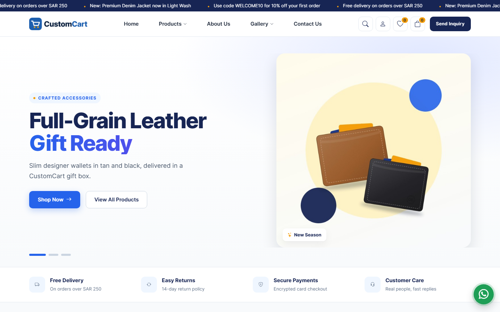
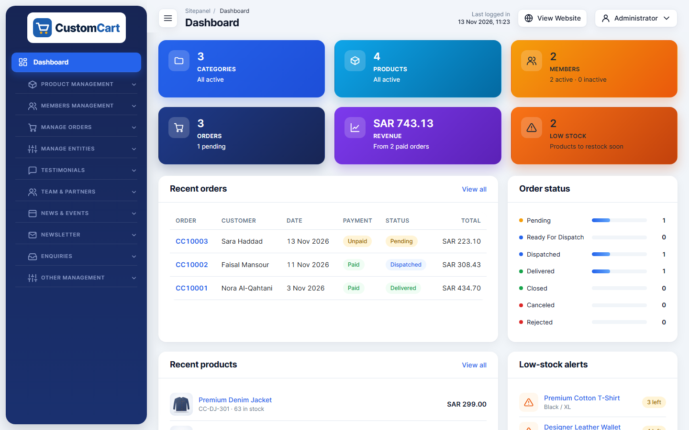

<div align="center">

# 🛒 CustomCart

**Complete Customizable E-Commerce Platform**

*Your Store, Your Way* — a full online store with a powerful admin panel (the **Sitepanel**),
built with PHP, MySQL and modern web technologies.


</div>

---

## Table of Contents

1. [Introduction](#introduction)
2. [Project Description](#project-description)
3. [Project Screenshots](#project-screenshots)
4. [Key Features](#key-features)
5. [Frontend Overview](#frontend-overview)
6. [Admin / Sitepanel Overview](#admin--sitepanel-overview)
7. [Technology Stack](#technology-stack)
8. [Project Requirements](#project-requirements)
9. [Installation Instructions](#installation-instructions)
10. [Database Configuration](#database-configuration)
11. [How to Access the Frontend](#how-to-access-the-frontend)
12. [How to Access the Sitepanel](#how-to-access-the-sitepanel)
13. [Default Demo Logins](#default-demo-logins)
14. [Project Folder Structure](#project-folder-structure)
15. [GitHub Repository Information](#github-repository-information)
16. [Future Enhancements](#future-enhancements)
17. [License](#license)

---

## Introduction

**CustomCart** is a complete, customizable e-commerce platform. One CodeIgniter 4
application serves both the public storefront and the **Sitepanel** — the
administration dashboard where the store owner manages products, orders,
customers, content, SEO and the look of the store.

## Project Description

CustomCart is designed to be adapted to any retail business. Products support
categories, colours, sizes, fabrics/materials, brands, per-variant stock,
image galleries, related products, FAQs and customer reviews. Shoppers can
browse, filter, add to a wishlist or cart, check out as a member or a guest,
apply discount coupons, and track their orders. Store owners control everything
from the Sitepanel: catalog, orders and returns, shipping, coupons, members,
static pages, banners, galleries, news & events, newsletters, meta tags and
theme colours.

The project follows an **HMVC** structure (one module per feature under
`modules/`), with every public URL and its SEO metadata stored in the database
(`wl_meta_tags`), so pages can be added and re-addressed without touching
route files.

## Project Screenshots

### Frontend — Home page



### Sitepanel — Dashboard



## Key Features

- 🛍️ **Product catalog** — categories, brands, colours, sizes, fabrics, variant stock, media gallery, related products and product FAQs
- 🛒 **Cart & checkout** — member and guest checkout, shipping methods, discount coupons, order confirmation and printable invoices
- 👤 **Customer accounts** — registration, login, address book, order history, wishlist, coupons, refer-a-friend, password reset
- 📦 **Order management** — order statuses, payment status, returns & refunds, cancellation reasons, low-stock alerts
- ⭐ **Reviews & testimonials** — product reviews and customer testimonials with moderation
- 📰 **Content management** — static pages, header images/banners, running marquee, FAQs, image & video galleries, team & partners, news & events, certificates & brochures
- 🔍 **SEO-ready** — database-driven URLs with per-page meta title, keywords and description
- 🎨 **Theme Management** — colour presets and dashboard card gradients editable from the Sitepanel
- 🔐 **Secure administration** — bcrypt passwords, sign-in lockout, CSRF protection, role-based sub-admin permissions
- 📊 **Bulk product upload** from spreadsheets (XLSX)
- 📧 **Flexible email** — PHP `mail()`, SMTP, SendGrid API or CodeIgniter Email
- 🧰 **Developer tooling** — `spark` generators for new modules, PHPUnit and Playwright end-to-end tests

## Frontend Overview

| Area | Pages |
|---|---|
| Home | Hero slider, featured & new products, categories, testimonials, news |
| Shop | Online store, product listing with filters, product detail, send inquiry / item request |
| Cart & Checkout | Cart, shipping, checkout, guest checkout, payment, order confirmation, invoice |
| My Account | Dashboard, edit account, address book, order history, wishlist, coupons, change password, refer a friend |
| Orders | Track order, printable invoice |
| Content | About us, our team, partners, testimonials, FAQ, image gallery, video gallery, news & events, certificates, brochures, sitemap, contact us |
| Authentication | Register, login, logout, forgot / reset password |

## Admin / Sitepanel Overview

The Sitepanel (`/sitepanel`) is a responsive admin dashboard with summary cards
(categories, products, members, orders, revenue, low stock), recent orders,
order-status breakdown, recent products and low-stock alerts.

| Menu group | Sections |
|---|---|
| Product Management | Products, Categories, Bulk Product Upload, Product Testimonials (reviews) |
| Members Management | Members (customers) |
| Manage Orders | Orders, Order Products, Shipping, Reasons, Returns & Refunds |
| Manage Entities | Colours, Sizes, Brands, Fabrics |
| Content | Testimonials, Team & Partners, News & Events, Newsletter, Enquiries / Product Enquiries |
| Other Management | Admin Settings, Theme Management, Banners, Header Images, Static Pages, Meta Tags, Discount Coupons, FAQs, Image & Video Galleries, Certificates & Brochures, Running Marquee, Refer a Friend, Locations, Sub-admins, Change Password |

Super admins see every section; sub-admins see only the sections granted to them.

## Technology Stack

| Layer | Technology |
|---|---|
| Backend | PHP 8.2+, [CodeIgniter 4.7](https://codeigniter.com/) (HMVC modules) |
| Database | MySQL 8.x (MySQLi driver, `utf8mb4`) — MariaDB 10.4+ also works |
| Frontend | HTML5, CSS3, Bootstrap 5.3, vanilla JavaScript, Google Fonts |
| Admin editor | CKEditor 4 |
| Web server | Apache 2.4 with `mod_rewrite` (WAMP / XAMPP / LAMP), or `php spark serve` |
| Dependencies | Composer (PHP), npm (end-to-end tests only) |
| Testing | PHPUnit, Playwright |

## Project Requirements

| Component | Requirement |
|---|---|
| PHP | **8.2 or newer** (a patched release is recommended) |
| PHP extensions | `intl`, `mbstring`, `mysqli`, `fileinfo`, `dom`/`libxml`, `json`; `openssl` for SMTP over TLS |
| Database | MySQL 8.x or MariaDB 10.4+ |
| Web server | Apache with `mod_rewrite` and `AllowOverride All` |
| Composer | 2.x |
| Node.js | 18+ (only to run the Playwright tests) |

> **WAMP users:** the PHP version used by Apache is chosen in *WAMP tray → PHP → Version*.
> It must be 8.2 or newer — with an older version every page shows
> *"Your PHP version must be 8.2 or higher to run CodeIgniter."*

## Installation Instructions

1. **Clone the repository** into your web root (e.g. `D:\wamp64\www` or `C:\xampp\htdocs`):

   ```bash
   git clone https://github.com/GAURAVPY-SPA/CustomCart.git customcart
   cd customcart
   ```

2. **Install PHP dependencies** (creates `vendor/`):

   ```bash
   composer install
   ```

   Use `composer install --no-dev --optimize-autoloader` on production servers.

3. **Create the environment file** from the template:

   ```bash
   cp .env.example .env        # Windows: copy .env.example .env
   ```

   For local development set at least:

   ```ini
   CI_ENVIRONMENT = development
   app.baseURL = 'http://localhost/customcart/'
   ```

4. **Create and import the database** — see [Database Configuration](#database-configuration).

5. **Check folder permissions** — `writable/` and `uploads/` must be writable by
   the web server (on Linux: `755` directories, owned by the PHP user; never `777`).

6. **Open the site** at `http://localhost/customcart/`.

**Alternative — built-in development server** (no Apache needed):

```bash
php spark serve --host 127.0.0.1 --port 8080
```

Then open `http://127.0.0.1:8080/`. In `development` mode the asset URLs follow
the address in the browser, so any port works.

## Database Configuration

1. **Create an empty database** named `customcart` with collation `utf8mb4_general_ci`
   (phpMyAdmin → *Databases*, or):

   ```sql
   CREATE DATABASE customcart CHARACTER SET utf8mb4 COLLATE utf8mb4_general_ci;
   ```

2. **Import** [`database/customcart.sql`](database/customcart.sql)
   (phpMyAdmin → *Import*, or from a terminal):

   ```bash
   mysql -u your_database_user -p customcart < database/customcart.sql
   ```

   The export contains the full schema (63 tables, indexes and foreign keys),
   the initial configuration (site settings, Sitepanel sections, SEO/URL registry,
   countries, currencies) and a small set of **fictitious demo data** — 3 categories,
   4 products with variants and images, 3 demo customers and 3 sample orders.
   It contains no real customer data and no real credentials.

3. **Set the connection** in `.env`:

   ```ini
   database.default.hostname = localhost
   database.default.database = customcart
   database.default.username = your_database_user
   database.default.password = your_database_password
   database.default.DBDriver = MySQLi
   database.default.port = 3306
   ```

`.env` is git-ignored — never commit it. Every available setting (cookies,
outgoing email, website URL) is documented in [`.env.example`](.env.example).

## How to Access the Frontend

| Setup | URL |
|---|---|
| WAMP / XAMPP (project folder in the web root) | `http://localhost/customcart/` |
| Virtual host pointing at `public/` | `http://customcart.local/` |
| `php spark serve` | `http://127.0.0.1:8080/` |

The root `.htaccess` forwards every request to `public/`, so `app/`, `modules/`,
`vendor/`, `writable/`, `uploads/` and `.env` are never served directly.

## How to Access the Sitepanel

Add `/sitepanel` to the frontend URL:

```
http://localhost/customcart/sitepanel
```

You are redirected to the sign-in page (`/sitepanel/login`); every other Sitepanel
page requires a signed-in, active administrator.

## Default Demo Logins

The demo database export ships with the following **local-development** accounts:

| Area | Username / Email | Password |
|---|---|---|
| Sitepanel (super admin) | `admin` | `Admin@12345` |
| Frontend customer | `nora@example.com` | `Customer@123` |

> [!WARNING]
> These passwords are public. Change them immediately after installing
> (Sitepanel → *Change Password*), and never deploy the demo accounts to a live site.

Useful commands:

```bash
php spark admin:reset-password admin     # reset a Sitepanel password (prompts, never echoed)
php spark sitepanel:create-admin         # create the first administrator on an empty tbl_admin
```

See [docs/SITEPANEL_ADMIN_PASSWORDS.md](docs/SITEPANEL_ADMIN_PASSWORDS.md) for the password rules and recovery options.

## Project Folder Structure

```
customcart/
├── app/                    Shared application code
│   ├── Commands/           spark commands (make:module, make:module-route, thumbnail cleanup)
│   ├── Config/             Central configuration (App, Database, Routes, Shop, Mail, Uploads, ...)
│   ├── Controllers/        BaseController, PublicController, AdminController, Uploads
│   ├── Database/           Migrations/ and Seeds/
│   ├── Helpers/            app, utils and other helpers
│   ├── Libraries/          SiteSettings, PageMeta, ImageUpload, Mailer, HtmlSanitizer, ThumbnailCache, ...
│   ├── Models/             BaseModel and shared models
│   └── Views/              Site layout (header/footer), error pages
├── modules/                HMVC feature modules
│   ├── home/  products/  category/  cart/  users/  members/
│   ├── pages/  gallery/  video/  news/  team/  testimonials/  certificates/
│   ├── brand/  color/  size/  material/  review/  lookup/
│   └── sitepanel/          Admin dashboard (Commands, Config, Controllers, Filters,
│                           Helpers, Libraries, Models, Views)
├── public/                 Web root: index.php, .htaccess, favicon, assets/
│   └── assets/             designer/ (storefront theme), sitepanel/, vendor/ (Bootstrap, CKEditor)
├── uploads/                Uploaded images & documents (served through a route, not directly)
├── writable/               cache/, logs/, session/, debugbar/, thumb_cache/ (must be writable)
├── database/
│   └── customcart.sql      Sanitized database export (schema + demo data)
├── docs/                   Developer documentation
│   └── screenshots/        README screenshots
├── tests/                  PHPUnit tests; e2e/ Playwright tests
├── .env.example            Environment template (copy to .env)
├── .htaccess               Forwards all requests to public/
├── composer.json / .lock   PHP dependencies
└── spark                   CodeIgniter CLI
```

### Developer documentation

| Document | Contents |
|---|---|
| [docs/PROJECT_ARCHITECTURE.md](docs/PROJECT_ARCHITECTURE.md) | Folder structure, request lifecycle, base classes, libraries, uploads, authentication |
| [docs/MVC_DEVELOPMENT_GUIDE.md](docs/MVC_DEVELOPMENT_GUIDE.md) | Coding conventions and a complete module walkthrough |
| [docs/DYNAMIC_ROUTING_AND_SEO.md](docs/DYNAMIC_ROUTING_AND_SEO.md) | `wl_meta_tags` URL registry, routing and SEO tags |
| [docs/MODULE_GENERATOR_COMMANDS.md](docs/MODULE_GENERATOR_COMMANDS.md) | `php spark make:module` and `make:module-route` |
| [docs/SITEPANEL_ADMIN_PASSWORDS.md](docs/SITEPANEL_ADMIN_PASSWORDS.md) | Admin password storage, rules and recovery |
| [docs/THUMBNAIL_CACHE.md](docs/THUMBNAIL_CACHE.md) | Image thumbnail cache |
| [tests/e2e/README.md](tests/e2e/README.md) | Running the Playwright end-to-end tests |

### Useful commands

```bash
php spark routes                    # list routes
php spark cache:clear               # clear writable/cache
php spark make:module <name>        # generate a new frontend module + its URL
composer test                       # PHPUnit (needs dev dependencies)
cd tests/e2e && npm install && npx playwright test   # end-to-end tests
```

## GitHub Repository Information

| | |
|---|---|
| **Repository** | `CustomCart` |
| **Description** | Complete Customizable E-Commerce Platform built with PHP, MySQL and modern web technologies. |
| **Clone** | `git clone https://github.com/GAURAVPY-SPA/CustomCart.git` |
| **Suggested topics** | `php` `codeigniter4` `mysql` `ecommerce` `shopping-cart` `admin-panel` `bootstrap5` |

**Not included in the repository** (see [.gitignore](.gitignore)): `.env`,
`vendor/` (run `composer install`), `node_modules/`, logs, cache, sessions,
IDE/OS files, and any database dump other than `database/customcart.sql`.

## Future Enhancements

- Integrate a live payment gateway (Stripe, PayPal, or a regional provider) — the checkout already has a placeholder step
- Multi-language and RTL storefront
- Multi-currency pricing with live exchange rates
- REST API for mobile apps and headless frontends
- Advanced sales reports and analytics exports
- Product variants with variant-specific pricing and images
- Email marketing automation (abandoned-cart reminders)
- Docker setup for one-command local installation
- CI pipeline running PHPUnit and Playwright on every pull request

## License

Released under the [MIT License](LICENSE).
Built on [CodeIgniter 4](https://codeigniter.com/), © CodeIgniter Foundation, MIT License.
